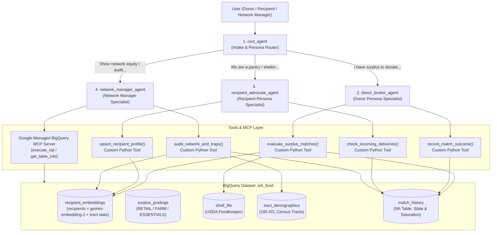

# Multi-Agent Architecture Plan: Atlanta Food Rescue & Surplus Network

**Project:** `qwiklabs-gcp-04-e030b511c03a`  
**Dataset:** `a4i_food`  
**Framework:** Google Agent Development Kit (`google-adk`)  

---

## 1. Executive Summary: How Many Agents Do We Need?

We evaluated two architectures for our **3 Personas** (*Donor, Recipient, Network Manager*) and **3 Tracks** (*Retail & Grocer Rescue, Farm Surplus, Critical Non-Food Items*):

| Architecture | Agent Count | How It Works | Pros | Cons |
| :--- | :---: | :--- | :--- | :--- |
| **Option A: Multi-Agent Hierarchy (Recommended)** | **4 Agents** *(1 Root + 3 Persona Specialists)* | A lightweight `root_agent` identifies the active persona and routes to `donor_broker_agent`, `recipient_advocate_agent`, or `network_manager_agent`. | • **1-to-1 Persona Mapping:** Each persona gets a dedicated system prompt, tone, and scoped toolset.<br>• **Parallel Team Development:** 3 teammates can build and test each specialist agent independently.<br>• **Cleaner Tool Selection:** Each sub-agent only chooses from 2–3 tools instead of 7+. | • Minor handoff latency when switching personas mid-conversation. |
| **Option B: Single Unified Orchestrator** | **1 Agent** *(+ 6 Tools)* | One `root_agent` handles all 3 personas and all tools in a single prompt. | • Zero handoff latency.<br>• Simplest mental model for cross-persona queries. | • Large monolithic prompt.<br>• Higher risk of tool-selection confusion or persona bleed. |

### Architectural Decision
We recommend **Option A: 4 Agents (1 Root Router + 3 Persona Sub-Agents)** deployed as a single unified ADK application in `agent/`.

> **Why we do NOT create separate agents for the 3 Tracks (`RETAIL`, `FARM`, `ESSENTIALS`):**  
> Tracks are **domain heuristic profiles**, not conversational personas. A single donor often has a mixed load (e.g., *"2 pallets of dairy (`RETAIL`) and 1 pallet of diapers (`ESSENTIALS`)"*). Keeping tracks as parameters inside the `donor_broker_agent`'s matching tool allows a single agent to handle mixed loads and dynamically shift scoring weights without bouncing the user between different agents.

---

## 2. Multi-Agent System Topology



---

## 3. Detailed Specification of the 4 Agents

### Agent 1: `root_agent` (The Dispatch Router)
- **Role:** Front-door coordinator for the Atlanta Food Rescue Network.
- **Responsibilities:**
  1. Greets the user and determines whether they are acting as a **Donor**, **Recipient Organization**, or **Network Manager** (or running a specific Challenge 2 evaluation prompt).
  2. Immediately delegates to the appropriate specialist sub-agent via ADK `sub_agents`.
  3. Allows seamless transitions if a user switches hats during a live demo (e.g., *"Now let's switch to the Network Manager view and see how that delivery changed our census tract coverage"*).

---

### Agent 2: `donor_broker_agent` (Donor Persona Specialist)
- **Target User:** Grocery store receiver (`RETAIL`), regional farmer/packer (`FARM`), or corporate/relief distributor (`ESSENTIALS`).
- **Persona Tone:** Fast, decisive, logistics-focused, zero friction.
- **Core Workflow:**
  1. **Conversational Surplus Intake:** Extracts item description, track (`RETAIL`, `FARM`, `ESSENTIALS`), pallet/case volume, cold-chain requirement, pickup location, and time window—either from free text or by looking up an existing `posting_id` in `a4i_food.surplus_postings` (`POST001`–`POST010`).
  2. **USDA Spoilage Grounding:** Queries `a4i_food.shelf_life` (handling hierarchy quirks like `Lettuce -> Spinach` and sentinel strings like `ripeness_dependent`) to compute the **Biological Spoilage Clock** ($H_{\text{urgency}}$).
  3. **Multi-Heuristic Tradeoff Brokerage:** Calls `evaluate_surplus_matches()` to run BigQuery `VECTOR_SEARCH` and score feasible candidates across 5 heuristics ($H_{\text{semantic}}$, $H_{\text{distance}}$, $H_{\text{equity}}$, $H_{\text{urgency}}$, $H_{\text{freshness}}$).
  4. **Presents 3 Actionable Tradeoff Cards:**
     - **Option A — Fastest / Lowest Spoilage Risk (`SPEED_OPTIMAL`)**
     - **Option B — Highest Community Impact (`EQUITY_OPTIMAL`)** with explicit marginal tradeoff explanation (e.g., *"+14 mins drive time reaches a census tract with 31% poverty and 0 deliveries this week"*).
     - **Option C — Split-Load Rescue (`LOAD_SPLIT`)** when a single high-equity pantry cannot absorb the full pallet count.
  5. **Guardrail Transparency:** Explains *which high-similarity organizations were filtered out and why* (e.g., flagging planted near-miss `Greenline Community Pantry` (`P00000000`) because `cold_storage = 'none'`).
  6. **"They Said No" Instant Failover:** Calls `record_match_outcome()` to write `CONFIRMED` or `DECLINED_CAPACITY` into the 5th table (`a4i_food.match_history`). If declined, automatically promotes the next-best candidate.

---

### Agent 3: `recipient_advocate_agent` (Recipient Persona Specialist)
- **Target User:** Food pantry director, church ministry volunteer, shelter coordinator, or mutual aid organizer.
- **Persona Tone:** Empathetic, respectful of volunteer constraints, dignity-first.
- **Core Workflow:**
  1. **Conversational Onboarding & Live Profile Updates:** Lets an existing pantry update its constraints (e.g., *"Our walk-in cooler is down until Friday"* or *"We urgently need infant formula and diapers"*) or onboards a brand-new organization in 3 conversational turns.
  2. **Real-Time `AI.EMBED` Indexing:** Calls `upsert_recipient_profile()` to update `a4i_food.recipients` and immediately re-compute the `gemini-embedding-2` vector in `a4i_food.recipient_embeddings` so the organization is instantly discoverable via `VECTOR_SEARCH`.
  3. **Incoming Match & Saturation Check:** Calls `check_incoming_deliveries()` against `a4i_food.match_history` so recipients can review recent/upcoming drops or temporarily pause deliveries when full.

---

### Agent 4: `network_manager_agent` (Manager Persona Specialist)
- **Target User:** Food Bank Dispatcher, Sustainability Director, or City of Atlanta Food System Planner.
- **Persona Tone:** Analytical, strategic, data-driven, equity-oriented.
- **Core Workflow:**
  1. **Google-Managed BigQuery MCP Integration:** Connects directly to the **BigQuery MCP Server** (`execute_sql`, `list_table_ids`, `get_table_info`) so the Manager can ask open-ended analytical questions across all 5 tables in `a4i_food`.
  2. **Metro Equity & Cold-Chain Deserts Audit:** Calls `audit_network_and_traps()` (or MCP SQL) to cross-reference `a4i_food.tract_demographics` (`poverty_rate`, `no_vehicle_rate`, `assistance_rate`) against `a4i_food.recipients` and `a4i_food.match_history`—highlighting high-need census tracts that lack walk-in refrigeration or recent deliveries.
  3. **Proactive Data Hygiene & Trap Detection:** Audits recipient profiles to surface:
     - **Internal Contradictions:** e.g., `Harborview Neighbors Trust` (`P00000001`), where `cold_storage = 'walk-in'` conflicts with `profile_text` (*"we have no freezer at present"*).
     - **Infrastructure Bottlenecks:** e.g., `Greenline Community Pantry` (`P00000000`), which repeatedly matches high on fresh produce demand but is rejected due to `cold_storage = 'none'`—turning a rejected match into a concrete capital grant recommendation.
     - **Tie-Breaking Verification:** Shows how `Cedar Street Produce Alliance` (`P00000002`) and `Maple Street Produce Alliance` (`P00000003`) are dynamically differentiated using `a4i_food.match_history` and census tract demographics.

---

## 4. Why the 3 Tracks Are Heuristic Profiles (Not Separate Agents)

Instead of fragmenting the user experience into a Retail Agent, Farm Agent, and Essentials Agent, `evaluate_surplus_matches()` accepts `category` (`RETAIL`, `FARM`, `ESSENTIALS`) and automatically applies track-specific hard filters and heuristic weights:

| Track | Hard Feasibility Gates | Default Heuristic Weights ($w$) | Primary Optimization Goal |
| :--- | :--- | :--- | :--- |
| **`RETAIL`** *(Grocer Rescue)* | • Cold-chain check (`walk-in` or `reach-in` if refrigerated; `frozen_storage = TRUE` if frozen)<br>• Open within `pickup_window_hours` | • $w_{\text{urgency}}$: **0.30**<br>• $w_{\text{distance}}$: **0.25**<br>• $w_{\text{semantic}}$: **0.20**<br>• $w_{\text{equity}}$: **0.15**<br>• $w_{\text{freshness}}$: **0.10** | Beat the biological spoilage clock (`shelf_life`) while minimizing food miles. |
| **`FARM`** *(Agricultural Surplus)* | • Bulk pallet check (`max_pallets >= pallets`, or triggers **Split-Load** across 2 recipients)<br>• `loading_dock = TRUE` or `refrigerated_transport = TRUE` for multi-pallet drops | • $w_{\text{semantic}}$: **0.30**<br>• $w_{\text{freshness}}$: **0.25**<br>• $w_{\text{equity}}$: **0.25**<br>• $w_{\text{distance}}$: **0.10**<br>• $w_{\text{urgency}}$: **0.10** | Move high-volume produce to high-throughput hubs without saturating the same pantry twice in one week. |
| **`ESSENTIALS`** *(Critical Non-Food)* | • Programmatic fit (`profile_text` serves families, unhoused neighbors, shelters, or youth)<br>• No refrigeration required | • $w_{\text{equity}}$: **0.45**<br>• $w_{\text{semantic}}$: **0.30**<br>• $w_{\text{freshness}}$: **0.15**<br>• $w_{\text{distance}}$: **0.10**<br>• $w_{\text{urgency}}$: **0.00** | Maximize demographic equity (`poverty_rate`, `no_vehicle_rate`, `assistance_rate`) since shelf life is infinite. |

---

## 5. Challenge 2 Rubric Compliance Matrix

| Challenge 2 Requirement (`README.md` / `agent/README.md`) | How Our 4-Agent Architecture Satisfies It |
| :--- | :--- |
| **Built with Google ADK (`agent/`)** | Uses `google.adk.agents.Agent` with `root_agent` orchestrating `donor_broker_agent`, `recipient_advocate_agent`, and `network_manager_agent`. |
| **Genuinely calls BigQuery `VECTOR_SEARCH`** | `evaluate_surplus_matches()` embeds the query with `AI.EMBED(..., endpoint => 'gemini-embedding-2')` and runs `VECTOR_SEARCH(TABLE a4i_food.recipient_embeddings, 'embedding', ...)` with `options => '{"use_brute_force":true}'`. |
| **Consumes at least one Google-managed MCP server** | Connected to the **BigQuery MCP Server** (or MCP Toolbox for Databases) for `network_manager_agent` and live schema/SQL inspection. |
| **Includes at least one custom-built tool** | Includes 5 custom Python tools (`evaluate_surplus_matches`, `record_match_outcome`, `upsert_recipient_profile`, `check_incoming_deliveries`, `audit_network_and_traps`). |
| **Handles planted traps (Decoys, Contradictions, Ties, Vocab Mismatch)** | • **Vocab mismatch:** Caught by `gemini-embedding-2` `VECTOR_SEARCH`.<br>• **Decoy (`P00000000`):** Caught by hard cold-storage filter and surfaced in the Match Brief.<br>• **Contradiction (`P00000001`):** Flagged by contradiction check and surfaced to Donor & Manager.<br>• **Ties (`P00000002` vs `P00000003`):** Broken deterministically via `tract_demographics` + `match_history`. |

---

## 6. Proposed `agent/` Directory Structure & Parallel Team Split

```text
agent/
├── __init__.py                 # Exports root_agent for ADK CLI / Cloud Run
├── agent.py                    # Defines root_agent and wires the 3 sub_agents
├── config.py                   # Project ID, dataset ('a4i_food'), model & heuristic weights
├── prompts.py                  # System instructions for root, donor, recipient, and manager agents
├── tools/
│   ├── __init__.py
│   ├── matching_engine.py      # evaluate_surplus_matches() (VECTOR_SEARCH + 5 heuristics + guardrails)
│   ├── history_ledger.py       # record_match_outcome() & check_incoming_deliveries() (5th BQ table)
│   ├── recipient_ops.py        # upsert_recipient_profile() (Live AI.EMBED re-indexing)
│   ├── network_audit.py        # audit_network_and_traps() (Equity deserts & contradiction scanner)
│   └── mcp_bigquery.py         # Google-managed BigQuery MCP toolset configuration
└── requirements.txt            # google-adk, google-cloud-bigquery, etc.
```

### How the Team Can Divide & Conquer
1. **Workstream 1 (Data & BigQuery Layer):** Materialize `a4i_food.recipient_embeddings` (with nearest census tract join) and create/seed `a4i_food.match_history`.
2. **Workstream 2 (Donor Broker & Tradeoff Engine):** Implement `matching_engine.py`, `history_ledger.py`, and `donor_broker_agent`.
3. **Workstream 3 (Recipient Advocate & Network Manager + MCP):** Implement `recipient_ops.py`, `network_audit.py`, `mcp_bigquery.py`, and the `recipient_advocate_agent` / `network_manager_agent` prompts.
