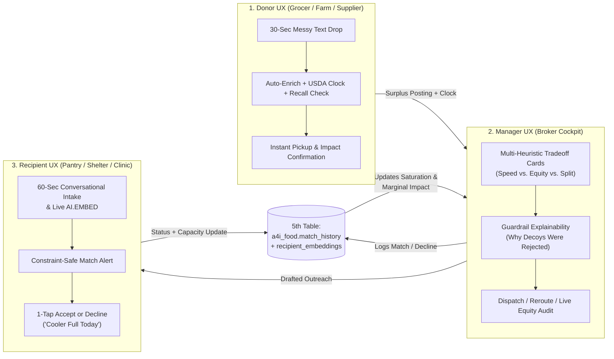

# Product & User Experience (UX) Strategy: 3-Persona Surplus Broker

**Project:** `$GOOGLE_CLOUD_PROJECT` (`a4i_food` — Atlanta Metro)  
**North Star Goal:** *Do not let food (or critical essentials) go to waste—and ensure rescue flows to high-need communities, not just the easiest loading docks.*

---

## 1. Executive Product Vision: Why a 3-Persona Closed Loop Beats a "Search Box"

Most teams in Challenge 2 will build a **single-user query tool**: a coordinator pastes a posting, BigQuery runs `VECTOR_SEARCH`, and the agent prints the top 3 rows.

From a **product perspective**, food rescue fails in the real world not because of a lack of search engines, but because **food rescue is a three-sided coordination problem under a ticking clock**:
1. **Donors** abandon the process if posting surplus takes more than 30 seconds or if nobody shows up before the dock closes.
2. **Recipients** get burned when brokers send them 8 pallets they cannot refrigerate, or ignore that they already received a drop two hours ago and their cooler is full.
3. **Managers (Brokers)** are forced to guess between *what is fastest* (sending every truck to the nearest giant warehouse in an industrial zone) and *what is most impactful* (reaching a high-poverty, low-vehicle neighborhood pantry before the spoilage clock runs out).

By designing around **all 3 Personas (Donor, Recipient, Manager)**, **all 3 Tracks (Retail, Farm, Essentials)**, a **Multi-Heuristic Tradeoff Engine**, and a **5th State Table (`a4i_food.match_history`)**, our product transforms from a static lookup into a **living, closed-loop marketplace where every action changes the state of the city's network**.

---

## 2. Deep-Dive UX by Persona

---

### Persona 1: The Donor (Store Manager, Farm Operator, Healthcare/Essentials Distributor)

#### Who They Are & Their Friction
- A grocery receiver at 2:10 PM with 10 crates of spinach blocking the loading dock, a farm manager looking at 5 tons of unharvested potatoes, or a distributor with 48 cases of infant formula.
- **Pain point:** They have **zero time** to fill out 15 dropdown fields, look up USDA shelf-life codes, or call five pantries that don't pick up. If it isn't effortless, the food goes into the compactor.

#### The Donor UX Experience ("30-Second Dock-to-Dispatch")
1. **Zero-Friction Natural Language Input:**
   - The Donor types or speaks a single messy sentence:
     - *Retail Track:* `"Pulling 10 crates of spinach and 40 gallons of milk, dock closes in 5 hours, needs cold chain."`
     - *Farm Track:* `"5 tons of potatoes in the field, can load pallets if someone brings a truck by Friday."`
     - *Essentials Track:* `"48 cases sealed infant formula, 8 months to expiry."`
2. **Automated Intelligence Behind the Scenes (Invisible to the Donor):**
   - **USDA Clock Resolution:** Resolves free text (`"spinach"`) to USDA FoodKeeper's actual taxonomy (`"Lettuce — Spinach"`), computing `hours_remaining = MIN(donor_window, usda_shelf_life)`.
   - **Safety Gate:** Checks if the item requires sealed packaging or OpenFDA recall screening (especially critical for infant formula and dairy).
   - **Volume & Logistics Parsing:** Infers pallet count, dock requirements, and whether refrigerated transport is needed.
3. **What the Donor Sees Back Immediately:**
   - **Feasibility & Pickup Assurance:** *"Verified: 6-hour safe cold-chain window. We have 3 verified Atlanta partners within 15 minutes who can clear your dock before 7:00 PM—including 2 with their own refrigerated vans (`refrigerated_transport = True`)."*
   - **Closed-Loop Impact Receipt:** Once matched, the Donor gets a clear impact summary (*"Your 10 crates were matched to a neighborhood pantry serving 240 families in a tract with 32% poverty and 26% car-free households"*), reinforcing repeat donor retention.

---

### Persona 2: The Recipient (Neighborhood Pantry, Soup Kitchen, Shelter, Clinic, Diaper Bank)

#### Who They Are & Their Friction
- Often volunteer-run (church basements, campus closets, mobile vans) or specialized (FQHC food-as-medicine clinics, halal/kosher pantries, diaper banks).
- **Pain points:**
  1. **No public operational profile exists**—nobody knows whether they have a walk-in cooler or a single domestic fridge, or whether they need a lift-gate vs. hand-carry.
  2. **Mismatched drops create waste**—getting sent uncertified meat at a halal pantry, or 6 pallets when they only have a household fridge, forces them to throw food away.
  3. **Capacity changes hour by hour**—if they took a large delivery this morning, their cooler is full this afternoon.

#### The Recipient UX Experience ("Conversational Intake & Protected Capacity")
1. **60-Second Conversational Onboarding (Closing the Missing-Data Gap):**
   - Instead of a complex spreadsheet, a new Atlanta pantry chats naturally with the agent:
     > *"We're West End Community Table. We open Tuesdays and Thursdays, serve about 180 families, and just got a commercial reach-in cooler donated, plus we can take up to 2 pallets if the truck has a lift gate."*
   - The agent asks **one smart operational follow-up** (*"Can you pick up with your own vehicle, or do you require delivery? Any dietary restrictions?"*), synthesizes their `profile_text` and structured flags, inserts into `a4i_food.recipients`, and runs `AI.EMBED` into `a4i_food.recipient_embeddings` **live**.
   - **Product Magic:** Within 5 seconds, that newly onboarded pantry is live in the vector space and can win the very next match in the demo.
2. **Dignified, Constraint-Verified Match Alerts:**
   - Recipients only receive outreach messages that already account for their exact storage (`cold_storage`), `max_pallets`, `service_days`, and dietary rules.
   - The outreach message drafted by the agent explicitly states **what is arriving, how many pallets, the clock margin, and whether transport is included**.
3. **Frictionless "Accept" or "Decline / Cooler Full" Loop (Writing to Table #5):**
   - If the recipient replies *"We have to pass today, our cooler is full from this morning's drop"*, the agent:
     - Logs `status = 'DECLINED'` (with reason) into `a4i_food.match_history`.
     - Temporarily marks their cold capacity as saturated for the day so they aren't spammed again.
     - Automatically notifies the Manager and promotes Backup Match #2 before the spoilage clock ticks down.

---

### Persona 3: The Manager / Rescue Coordinator (The Broker Command Center)

#### Who They Are & Their Friction
- The regional coordinator sitting between dozens of donors, 127 Atlanta recipient organizations, and a limited pool of trucks/volunteer drivers at 4:00 PM on a Thursday.
- **Pain points:**
  1. **The "Warehouse Trap":** Pure similarity or capacity sorting sends everything to the largest regional warehouse in an industrial park, starving smaller neighborhood pantries in high-poverty, car-free census tracts.
  2. **The "Near-Miss Decoy" Risk:** A pantry's profile talks passionately about wanting fresh greens (`Greenline Community Pantry`), so semantic search ranks it #1—but it has **zero refrigeration**.
  3. **The "They Said No" scramble** and **Oversized Farm Loads** that no single small pantry can take.

#### The Manager UX Experience ("The Multi-Heuristic Tradeoff Cockpit")
1. **Side-by-Side Heuristic Tradeoff Recommendations (Instead of a Single Opaque Rank):**
   - When the Manager evaluates a posting, the agent runs `VECTOR_SEARCH` + Hard Constraint Filtering + `match_history` Join + `tract_demographics` Join, and presents **explicit tradeoff choices**:
     - **Option A — Speed & Logistics Optimal (`SPEED_OPTIMAL`)**:
       - *Shortest distance (e.g., 1.8 miles), recipient has own reefer van (`refrigerated_transport = True`), 4.5-hour buffer on the 6-hour clock. Census tract need: Moderate (13% poverty, 9% no-vehicle).*
     - **Option B — Maximum Equity Impact Tradeoff (`EQUITY_OPTIMAL`)**:
       - *Trades off +3.4 miles of distance (+12 mins drive time, still 4.0 hours inside the spoilage clock) to reach a pantry in a **36% poverty / 29% no-vehicle tract** that has received **0 deliveries in the last 14 days** (from `match_history`). Net Equity Impact: **+74% higher**.*
     - **Option C — Resilience / Split-Load Plan (`LOAD_SPLIT` or `FALLBACK`)**:
       - *For Track 2 (Farm Surplus — e.g., 5 tons of potatoes / 30 bins of squash):* Automatically proposes splitting the load across 3 high-need pantries or pairing a Regional Hub (`loading_dock = True`) with a Mobile Pantry (`cold_storage = 'vehicle'`) that drives directly into low-vehicle-access neighborhoods.
2. **"Guardrail Transparency" — Showing Why Decoys & Contradictions Were Eliminated:**
   - Right below the recommendations, the Manager sees a **"Filtered Near-Misses (Safety & Capacity Guardrails)"** box:
     - 🚫 *`Greenline Community Pantry` — High semantic match (0.84) for fresh greens, **ELIMINATED**: `cold_storage = 'none'` (spoilage risk).*
     - 🚫 *`Harborview Neighbors Trust` — **FLAGGED / ELIMINATED**: Profile text contradiction (claims walk-in freezer and 6 pallets, but states "single shelf in a shared cupboard and no freezer at present").*
   - This gives the coordinator instant confidence that the agent is checking operational reality, not just keywords or embeddings.
3. ** Dynamic Saturation Awareness (Powered by the 5th Table `match_history`):**
   - Suppose `Cedar Street Produce Alliance` and `Maple Street Produce Alliance` are tied on capability (the planted *Genuine Ties* in the corpus).
   - The Manager can see that `Cedar Street` already received 6 pallets of produce 3 hours ago in `match_history`—reducing their remaining pallet capacity and marginal impact—so the agent dynamically elevates `Maple Street` (or a higher-need tract recipient) and explains why!
4. **One-Click Live Equity Audit ("Where Did the Food Actually Go?"):**
   - The Manager can ask: *"Run our Atlanta Equity Audit."*
   - The agent queries `a4i_food.match_history` joined with `a4i_food.tract_demographics` and compares our brokered deliveries against the **Atlanta Metro Baseline** (`20.2%` poverty, `14.7%` no-vehicle, `19.1%` public assistance), proving quantitatively whether our heuristic tradeoffs shifted food toward high-need, transit-isolated neighborhoods.

---

## 3. Product Differentiation Matrix: Why This Wins the Rubric

| Judging Dimension | What 90% of Teams Will Demo | What Our Product Demos (Our Edge) |
|---|---|---|
| **Impact & Insight (30 pts)** *Would a coordinator actually use this?* | A single ranked list for 1 persona with generic explanations. | **3-Persona Closed Loop + Pareto Tradeoff Engine:** Shows *Speed vs. Equity vs. Saturation* tradeoffs with concrete miles, clock margins, and tract poverty/no-vehicle numbers, plus **Load-Splitting** for Farm Surplus. |
| **Technical Execution (30 pts)** *Is vector search genuinely used + ADK + MCP?* | Basic `VECTOR_SEARCH` query wrapped in a single tool. | **Full Lifecycle Vector + State Pipeline:** `VECTOR_SEARCH` (`gemini-embedding-2`, brute-force) + **Live `AI.EMBED` on Recipient Intake** + **5th BQ Table (`match_history`)** dynamically adjusting capacity & marginal impact + MCP integration. |
| **Rigor & Judgment (25 pts)** *Can you defend decisions, traps & bias?* | Fails to notice `Greenline` (decoy) or `Harborview` (contradiction), or hides filtering inside a black box. | **Explicit Guardrail Transparency + Live Equity Audit:** Surfaces eliminated decoys/contradictions directly in the Match Brief, breaks genuine ties (`Cedar` vs. `Maple`) using `match_history` + census need, and runs a live Metro Equity Audit. |
| **Craft & Communication (15 pts)** *Does the story land in 3 minutes?* | Talking through SQL queries or raw JSON outputs. | **Role-Based Story Arc:** A crisp 3-minute narrative following a real Atlanta surplus event from **Donor** drop -> **Manager** tradeoff & decoy catch -> **Recipient** intake/response -> **5th Table** impact shift. |
| **Bonus — Range (+10 pts)** *Breadth that serves the solution* | Bolted-on features that don't affect matching. | **Live Conversational Intake + Semantic USDA Clock Lookup + 5th Table State Persistence**—every extra feature directly improves match quality. |

---

## 4. Recommended "Golden Thread" Demo Script (3 Minutes, All 3 Personas)

To make the product story unforgettable for the judges (who watch the recorded pitch video asynchronously with no Q&A), we can structure our demo around **four crisp beats**:

1. **Beat 1 — The Donor Drop & The Ticking Clock (Retail Track, ~30s):**
   - A **Donor** submits a messy Atlanta offer: *"10 crates of fresh spinach, harvested yesterday, must leave dock in 6 hours, needs cold storage."*
   - The agent resolves `"spinach"` to USDA FoodKeeper's `"Lettuce (Spinach)"`, confirms the 6-hour clock, and triggers the broker.
2. **Beat 2 — The Manager Tradeoff & Guardrail Catch (~60s):**
   - The **Manager** views the Match Brief:
     - **Guardrail Callout:** Shows that `Greenline Community Pantry` matched #1 semantically on "fresh greens" but was **automatically blocked** because `cold_storage = 'none'`, and `Harborview Neighbors Trust` was blocked for a profile contradiction.
     - **Heuristic Tradeoff:** Compares **Option A (Closest / Fastest)** vs. **Option B (High-Equity Tradeoff)**—showing that adding just 3.5 miles of drive time reaches an Atlanta census tract with **2.1x higher no-vehicle households** and **zero deliveries in the past 14 days** (verified via our 5th table, `match_history`).
     - Also shows how the **Genuine Tie** (`Cedar Street` vs. `Maple Street`) is broken because `Cedar Street` already received a delivery earlier today in `match_history`!
3. **Beat 3 — "They Said No" + Farm Load Split (~45s):**
   - When a recipient declines (*"Cooler full today"*), the agent logs `DECLINED` to `match_history` and instantly promotes the next match with a drafted message.
   - Then, for **Farm Surplus** (*"5 tons of potatoes"*), the agent demonstrates a **Multi-Recipient Split Match** across compatible sites since no single neighborhood pantry can hold 10 pallets.
4. **Beat 4 — Recipient Live Intake + The Metro Equity Audit (~45s):**
   - A new **Recipient** pantry onboards via a 2-turn conversation, gets embedded live via `AI.EMBED`, and is immediately searchable.
   - Finally, the **Manager** runs the **Atlanta Equity Audit**, proving with live BigQuery numbers that our Multi-Heuristic Tradeoff Engine directed surplus to census tracts with significantly higher poverty and lower vehicle access than the Atlanta metro average (`20.2%` poverty / `14.7%` no-vehicle).
