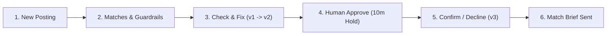

# ATL RescueGuard — Hackathon Specification & Build Plan

## 1. The Idea, in One Sentence

**ATL RescueGuard** is a self-correcting food dispatcher that owns a dispatch ticket from posting to hold, checks its own work, splits loads that don't fit, and re-plans when someone says no.

> [!IMPORTANT]
> Not a search box. Not a list of pantries. A **ticket** that goes through versions, gets approved by a human, and gets locked so it can't be double-booked.

---

## 2. The Problem

A Metro Atlanta coordinator has **hours, not days**, to move expiring food. If she trusts meaning search alone, she will:

- **Send fresh food to a pantry with no fridge**, because its bio begs for fresh greens.
- **Send recalled food to families**, because no one checked.
- **Waste half a farm load**, because no single pantry can fit it all.
- **Always give food to the biggest pantry with the best fridge**, while small high-need pantries never win.

That's not a search problem. It's a **checking, splitting, fairness, and holding** problem.

---

## 3. Who It's For, and What Track

### Tracks

- **Primary Track: Track 1 – Retail & Grocer Rescue**
  - Small, perishable, clock-ticking offers.
  - This is the main demo and the track to name early in the deck (judges score against the chosen track).
- **Supporting Modes: Track 2 – Farm Surplus & Track 3 – Critical Essentials (Diapers / Formula)**
  - Supporting modes on the same system, not three separate products (starter allows combining tracks).

### Three Personas, One Ticket

| Persona | Role | Access & Actions |
| :--- | :--- | :--- |
| **Coordinator / Dispatcher** | Main user (internal staff) | Runs the desk, approves plans, sees everything. |
| **Donor** | Supplier | Posts an offer with pickup address and deadline; tracks its own offer only. |
| **Recipient Pantry** | Receiver | Sees only offers made to it; confirms or declines in one tap; updates its own cold storage / capacity. |
| **End Beneficiaries** *(No Login)* | People who need food | Benefit indirectly via their local pantry getting the food. **We never collect their personal data.** |

---

## 4. The Demo Story – One Afternoon, Three Postings

### 2:10 PM – Posting 1: Grocer Spinach (Track 1)
> *"10 crates spinach, harvested yesterday, needs cold storage, must leave by 8pm"* — **6 hours left.**

1. **Supervisor** creates Ticket `RG-1042`, **Plan v1 DRAFT**.
2. **Matcher** finds candidates by meaning, not keywords.
3. **Constraint Worker** drops the bad ones with plain reasons, including the **#1 meaning match** with no cold storage.
4. **Planner** says the best survivor can only take 4 crates, so it proposes a split, calculated in code.
5. **Checker** rejects Plan v1 — it wastes 6 crates and serves a low-need area while a high-need area nearby gets zero.
6. **Fixer** rewrites it to **Plan v2** — split, verified, equity-checked.
7. **Coordinator** approves v2. **Firestore** starts a **10-minute hold**. No other driver can double-book those crates.
8. **Match Brief** is generated with **top 3 options** (not just top 1, because *"they said no"* is normal).

- **Bonus in the same posting – FDA Safety Brake:**
  - Same grocer also offers deli meat. Before matching, the system checks **openFDA recalls**, finds a match, and shows:
    `HALTED BY FDA SAFETY GUARDRAIL – meat blocked, spinach proceeds.`
  - If the FDA check fails, it says **`not checked`**, never **`clear`**.
- **Bonus in the same posting – Tie-Breaker:**
  - Two pantries tie exactly on capability. The system breaks the tie with numbers shown:
    1. **Distance** first
    2. **Tract need** (`poverty + no-vehicle`)
    3. **Recent donation history** (who hasn't been served recently wins)
- **Decline – Why a Ticket Matters:**
  - Pantry B declines. Supervisor doesn't restart.
  - Marks B declined → promotes Pantry C → keeps the hold on A → creates **Plan v3** → coordinator approves v3 → donor sees only the final pickup plan.
  - Chat and screen both update from the same ticket.

### 3:00 PM – Posting 2: Farm Load (Track 2) & Essentials (Track 3)

- **Farm Load (Track 2):**
  - **12 pallets of potatoes.** No pantry fits it whole.
  - Planner doesn't drop it — builds a **3-stop split (`4 + 4 + 4`)**, each within capacity, cold, window, and margin, calculated in the **Code Execution sandbox** (code + output shown).
- **Essentials (Track 3), in the same afternoon:**
  - **Sealed formula and diapers.** The shelf-life table has blank numbers for both (diapers aren't food; sealed formula is only tracked after opening).
  - System says: `"USDA shelf-life not applicable – falling back to donor window"`, never a silent `0`.
  - There is no product called exactly `"Spinach"` in that table — it's a subtitle under `"Lettuce"`. The system finds it, uses the conservative end of the range, and **donor deadline still beats the book**.

### 4:00 PM – Bonus Showstopper: Desert to Green

- A donor offers **fresh milk near South Atlanta**.
- The matcher has to send it **12 miles away** because every local pantry lacks cold storage.
- The map shows high-poverty, low-car areas with zero cold-storage pantries within 5 km glowing red — a **Cold-Chain Desert**.
- **Live Onboarding:** A local church onboards live: *"We just installed a walk-in cooler, we can take 3 pallets on Tuesdays."*
- Agent writes it to **BigQuery**, embeds its profile so meaning search can find it, re-runs the match, **the desert flips to green**, and milk routes into the neighbourhood that needed it most.
- *(Labelled `simulated` in the demo; location is ZIP-area, not a precise street address.)*

---

## 5. The Workflow, in Clicks

1. **New Posting** – Coordinator / donor enters: what, how much, cold or not, deadline, pickup address.
2. **Matches** – Ranked list with plain reasons for each fit and each drop, plus time margin: `"6 hours left, collect in 2, margin 4 hours"`.
3. **Check** – If v1 wastes food or misses high-need areas, it's rejected on screen; fixed split appears as v2.
4. **Approve** – Coordinator clicks **Approve**. Starts the **10-minute hold** (does not auto-send trucks).
5. **Confirm / Decline** – Pantry confirms in one tap, or declines and the ticket re-plans to the next pantry.
6. **Brief Sent** – Coordinator gets a ready-to-send message: who, what, how much, by when, next two backups, plus a **Guardrails callout**.

> [!TIP]
> **Clock-First Queue:** Queue is sorted by **expiry**, not by posting order. A 2-hour milk offer outranks a 2-day potato offer, even if potatoes arrived first.

---

## 6. The Agents, and What Each One Does

**Core: 9 Agents | Bonus: 1 Agent**

| # | Agent | Role | Responsibilities & Guardrails |
| :--- | :--- | :--- | :--- |
| **1** | **Supervisor** | Dispatcher Brain | Owns the ticket, versions, routing, approvals, holds, loop guards. Never ranks or checks itself; routes and enforces: no plan without a check, no approval without a human, max 3 fixer tries then escalate. |
| **2** | **Matcher** | Meaning Worker | Turns a messy posting into a meaning vector; searches pantry profiles by meaning via **Gemini embeddings + vector search** (genuinely called, not keyword search). Returns candidates only, never decides. |
| **3** | **Constraint + Last-Mile Worker** | Reality Worker | Deterministic checks: cold/frozen fit, capacity, max pallets, pickup window vs. hours left, service day, distribution before spoiling, self-collect (`refrigerated_transport`) vs. needs cold driver, loading dock vs. hand-unload, dietary/cultural hard constraints (halal, pork-free, infant, medically restricted). **Columns beat text** — contradiction = flag for human check, not a guess. |
| **4** | **Recall Guard** | Safety Worker | Checks **openFDA** before matching. Recall match = halt that item. Check fails = `"not checked"`, never `"clear"`. |
| **5** | **Planner / Splitter** | Maths Worker | Builds plans deterministically in code. Whole load fits = send whole. Doesn't fit = split across 2–3 verified pantries. Essentials use different rules: no cold chain, but safety / size / donor window matter more. |
| **6** | **Checker / Auditor** | Independent Veto | Does not help make the plan — tries to kill it: waste? unsafe fit? low-need skew? concentration (same pantries served yesterday, others zero)? donor deadline ignored? If yes: **REJECTED**, with reason shown on screen. |
| **7** | **Fixer** | Editor | Rewrites only what Checker flagged. Max 3 tries; same plan twice or 3 fails = escalate to human. No infinite loop. |
| **8** | **Impact & Fairness Worker** | Scorekeeper | Calculates Impact Score before approval and keeps the fairness ledger: who got what, when, confirmed / declined / no-show. Next match boosts pantries not served recently so big pantries don't win every time. Unknown history = neutral, not a penalty. |
| **9** | **Guide** | Talker, Everywhere | Floating assistant on every screen in all three role views. Knows the ticket (`session_id`, `ticket_id`, `plan_version`, `step`, `role`, `hold_status`). Proposes action cards, never executes alone. A chat `"yes"` is a proposal until the approve call succeeds. |
| **10** | **Onboarding / Intake** *(Bonus)* | Live Intake Worker | New pantry joins in 60 seconds, writes to BigQuery, embeds profile into both recipient and embeddings tables, re-runs match, flips a desert to green. |

---

## 7. Conversational Agent – Seamless UI ↔ Chat & Persona Handoff

### UI ↔ Chat Seamless Sync (Single Source of Truth in Firestore)

- **UI → Chat:** Every chat message carries `session_id`, `ticket_id`, `posting_id`, `plan_version`, `step`, `role`, `hold_status` — Guide already knows which ticket you're on without re-typing.
- **Chat → UI:** Guide returns `answer + state_update`; UI re-renders ticket, cards, clock, hold timer, and impact panel from that same state.
- **Action Safety:** Chat `"yes"` alone does nothing until `Approve` succeeds. Mid-ticket switch must be acknowledged. Unfinished `DRAFT` shows as unfinished.
- **Resilience:** Disconnect = resume by ticket ID (fresh restart is acceptable demo fallback, but persistence itself is mandatory for audit / holds / versions).

### What Guide Can Do

- **Answer from the already-checked ticket with sources:**
  - Who, why them, why not the big downtown pantry, who's next after a decline, how long spinach lasts, whether they can self-collect or need a driver, whose neighbourhood this helps, Impact of v2 vs. v1, who got served this week.
- **Guided intake & clarification:**
  - Step-by-step guidance; asks for exact missing fields if a posting is vague; stops after **3 clarifications** with no new info and falls back to form / human.
- **Propose actions via one card per action:**
  - `Approve`, `Promote Next`, `Re-run Match`, `Check Recall`, `Onboard`.
- **Ad-hoc data questions:**
  - Uses guarded read-only MCP query, shows **SQL + job ID**, and **never** feeds that answer back into ranking.

### What Guide Cannot Do Alone

- Approve, send, dispatch, or book a truck.
- Change an approved plan without a new version, Checker pass, and human approval.
- Override cold, recall, hold, or capacity constraints.
- Invent capacity, address, or cold storage (`unknown` is `"unrecorded"`, not a guess).
- Access personal contacts or end-beneficiary personal data.
- Guarantee road time without Routes.
- Auto-approve on silence.

### Persona Handoff Contract

- **Ticket Lifecycle:** `Donor posts` → `Coordinator reviews` → `Recipient confirms` → `Coordinator + Donor notified`.
- **Audit Trail:** Each transition is a state change with a version record: *who, in which role, when, what changed*.
- **Role-Filtered Views (Enforced in Backend, Not Just UI):**
  - **Coordinator:** Sees everything — all matches, checker reasons, impact, fairness.
  - **Donor:** Sees only its own offer — matched pantries, hold status, final pickup plan (not other donors, not other pantries' scores).
  - **Recipient:** Sees only offers made to it — what, how much, by when, why it fits, confirm / decline (not other pantries' allocations, not coordinator's internal notes).
- **Decline & Cancel Handling:**
  - Decline goes back to Coordinator, not directly to Donor. Donor sees `"matching updated"`, not internal re-plan details (unless Coordinator shares them).
  - Cancel releases all holds; recipients get `"offer withdrawn"`.
- **Role Switch Acknowledgement:**
  - Guide explicitly acknowledges switches: *"Switching to Recipient view, South Atlanta Food Hub, same ticket RG-1042, your offer is 6 crates, pending approval."*
  - Guide never reveals another persona's private view in chat.

---

## 8. Need, Fairness, and "Does the Recipient Deserve It?"

We don't judge moral deserve. We measure **need + fit + fairness**, show it transparently, and let the coordinator decide.

### Need (from `tract_demographics`)

- **Columns available:** `geo_id`, `tract_lat`, `tract_lon`, `total_pop`, `median_income`, `poverty_rate`, `no_vehicle_rate`, `assistance_rate`. *(No race columns.)*
- **Formula:**
  $$\text{Need} = 0.6 \times \text{poverty\_rate} + 0.4 \times \text{no\_vehicle\_rate}$$
- **Missing tract handling:** Treated as `unknown`, falls back to weekly households, flagged — **never treated as zero**.
- **Fit first, need second:** A high-need pantry with no fridge still cannot take fresh food. Among viable pantries, higher need wins, and on a tie, need breaks it.

### Fairness Over Time

- **Allocation Ledger** prevents concentration.
- A pantry served 5 times this week vs. a pantry served 0 times: the 0-times pantry gets a **rotation boost** next time, even if slightly smaller.
- Without this, logistics wins every time (big pantries with detailed profiles and docks win, small high-need pantries never win, and the equity audit just proves it).

### How `tract_demographics` Is Used (and Not Used)

- **Used in 5 places:**
  1. Need score in ranking
  2. Equity audit after match (chosen tracts vs. metro average — did food go where need is, or where docks are?)
  3. Desert detection (`poverty > 30%` + `no_vehicle > 40%` + `zero cold pantries within 5 km` = red)
  4. Impact Score Equity component
  5. Tie-breaker
- **NOT used for:**
  - Eligibility alone, ranking by income alone, or individual need (it is area-level, not a headcount, and we never sum overlapping groups as unique people).
- **Join Gap to Verify in Phase 1:**
  - Recipients have ZIP-centroid `lat/lon`, not a `tract_id`. Join is **nearest tract by distance** via `LEFT JOIN` so a missing tract doesn't drop a pantry. Must be verified against the actual Atlanta tables.

---

## 9. Impact Score – Live, Before Approval

Shown as a transparent breakdown **before** clicking Approve (`v1` vs. `v2` vs. `Do Nothing`), not a black-box number after the fact.

| Component | Weight | What It Measures |
| :--- | :---: | :--- |
| **Need** | **30** | Households served, weighted by `poverty + no-vehicle` in their tracts |
| **Food Rescued** | **25** | Crates placed vs. offered, spoilage avoided (`10/10` = full; `4/10` with 6 wasted = low, even if the 4 went to a great pantry) |
| **Equity** | **25** | Share to high-need tracts vs. metro average, plus deserts cleared |
| **Reliability** | **20** | Cold fit, recall cleared, time margin positive, pantry confirmed before |
| **Total** | **100** | **Live Pre-Approval Impact Score** |

### Illustrative Comparison

- **Plan v1 (Impact 52):** Need `70`, Rescue `30` (6 wasted), Equity `40`, Reliability `80`
- **Plan v2 Split (Impact ~89):** Need `88`, Rescue `100` (10/10), Equity `82`, Reliability `85`
- **Do Nothing (Impact 0):** 10 crates spoiled by 8:00 PM

### Cumulative Dashboard (Same Score Over Time)

- Total crates rescued
- Estimated households reached *(explicitly labelled `estimated`, not unique people)*
- Deserts cleared vs. still red
- Waste avoided
- Decline rate
- Top-3 pantries' share vs. rest *(flags concentration if top 3 creep toward 80%)*

---

## 10. Planted Traps – Guardrail Transparency (Core, Not Bonus)

The corpus contains **9 planted teaching cases** flagged `profile_source = 'planted'` — invented, adversarial rows designed to catch naive matchers:
- **1 Decoy:** *Greenline Community Pantry* — Semantic #1 for fresh greens, `cold_storage = 'none'`. **Caught:** Dropped in red (`"meaning is not capacity"`).
- **1 Contradiction:** *Harborview Neighbors Trust* — Bio says walk-in freezer in one sentence, *"single shelf in a shared cupboard and no freezer"* in the next. **Caught:** Columns win; flagged `"Needs human check"`, not auto-matched.
- **2 Genuine Ties:** *Cedar Street & Maple Street Produce Alliance* — Identical operations, different words. **Caught:** Deterministic tie-breaker (distance → tract equity → recent history, with numbers shown).
- **5 Vocabulary-Mismatch Cases:** Should match, but words differ completely — keyword search misses them, meaning search finds them (proof vector search is genuinely used).

### Mandatory Match Brief Callout

Every Match Brief must include a section named **exactly**:
> **`Safety & Capacity Guardrails: Why Top Semantic Matches Were Filtered`**
> Shows semantic ranking *before* filter → ranking *after* filter, with plain reason and evidence for each drop, flag, or tie-break.

> [!WARNING]
> **Phase 1 Verification Check:** Query `WHERE profile_source = 'planted'` in the Atlanta event project first. The names above (*Greenline*, *Harborview*, *Cedar/Maple*) came from the Chicago analysis — verify the exact planted names in the Atlanta dataset before putting them in the deck, and label planted cases as *starter teaching cases*, not real pantries' actual fridge status.

---

## 11. Last-Mile, Addresses, and Maps – Honest Limits

### Addresses Available

- **Recipients:** `street`, `city`, `state`, `zip`, `lat/lon` (ZIP centroid), IRS org address (public, org only, no personal contacts). Show in Brief and cards, link to Maps, and label distance **`ZIP-area approximate`**.
- **Surplus Postings:** No address or `lat/lon` in starter data — just synthetic text. **Donor enters pickup address at posting** (new input), enabling donor-to-recipient matching.
- **Tracts:** Area points used for need scoring, not door-to-door routing.

### Capability Boundaries

| Last-Mile We CAN Do (from Starter Fields) | Last-Mile We CANNOT Do (Without Adding Data / APIs) |
| :--- | :--- |
| Self-collect vs. needs driver (`refrigerated_transport`) | Live driver fleet tracking |
| Loading dock vs. hand-unload | Van size / live van temperature telemetry |
| Max pallets & pickup window vs. hours left | Real road time / live traffic *(unless Google Routes wired)* |
| Service day alignment | Turn-by-turn multi-stop route optimizer |
| Distance from ZIP centroids + travel buffer + margin calculation | GPS delivery confirmation |

### Maps Plan

- **Display:** Leaflet + OpenStreetMap (free, no API key required).
- **Donor Address → Coordinates:** Google Geocoding once at posting, fallback to ZIP centroid if it fails.
- **Drive Time:** Google Routes for top matches only; fallback to straight-line ZIP distance labelled `"estimated, not road time"` (never claim *"12 minutes to the door"* without Routes).
- **Privacy / Terms Rule:** Never store Maps phone numbers, reviews/text, or photos — only coordinates, drive time, or `place_id` if used.
- **Build Priority:** Wire live Geocoding / Routes in the bonus phase *after* core matcher / checker / hold works, so a pretty route to the wrong pantry is never the demo.

---

## 12. What Makes Us Stand Apart

### User Experience

- **Ticket, not list:** Three role views, one stateful ticket.
- **Clock-first queue:** Sorted by urgency/expiry, not arrival time.
- **Reasons, not ranks:** Compare `v1` vs. `v2` before approving.
- **One-tap resilience:** Decline in one tap, re-plan automatically.
- **Live Cold-Chain Desert flip:** Desert to green in 60 seconds.
- **Low friction:** Donor `< 1 min`, Pantry `1 tap`, Coordinator `1 click`.
- **Guardrails Callout:** Explicitly shows rejected #1 semantic match, not just final winners.

### Backend Intelligence

- **Separation of powers:** Meaning finds → Maths decides fit → Independent Auditor tries to break the plan.
- **Deterministic planner:** Calculations run in code and are shown; the model never guesses numbers.
- **Stateful & transactional:** Versions, transactional **Firestore holds** (BigQuery is the wrong tool for a lock), declines, and allocations remembered so the system gets fairer over time.
- **Time-aware & fairness-aware:** Equity audited after match, never using race.
- **Honest unknowns:** `unrecorded ≠ no`, `not-checked ≠ clear`, `ZIP distance ≠ road time`, `donor deadline beats book`, `columns beat text`.
- **Full evidence trail:** Which search ran, which constraints killed which pantry, which checker rejected v1 and why, who approved v2, when the hold started, and what the Impact Score was at approval.
- **Visible tool execution:** Managed BigQuery MCP for live queries (`SQL + job ID` shown) and Code Execution for splits/margins (`code + output` shown).

---

## 13. Next Steps, in Order

1. **Verify Data in Event Project**
   - Confirm Atlanta table counts (~135 recipients, 10 postings, 661 shelf-life rows).
   - Query `WHERE profile_source = 'planted'` to get the exact Atlanta planted trap names.
   - Verify nearest-tract join method (`LEFT JOIN` by distance) and check whether Maps APIs are enabled.
2. **Matcher + Constraint Worker**
   - Gemini meaning search, hard deterministic filters, and basic last-mile checks.
3. **Checker / Fixer + Hold + Match Brief**
   - `v1` reject → `v2` split, human approve, 10-minute Firestore hold, and mandatory `Safety & Capacity Guardrails: Why Top Semantic Matches Were Filtered` callout in every Brief.
4. **Impact + Fairness**
   - Pre-approval Impact Score (`v1` vs. `v2` vs. `Do Nothing`), allocation ledger, and rotation boost.
5. **Roles & Persona Handoff**
   - Coordinator / Donor / Recipient views backed by the same ticket, backend role filtering, persona handoff contract, and addresses on both sides.
6. **Maps Bonus**
   - Geocode donor address, Routes for top matches, fallback to labelled ZIP-centroid distance.
7. **Onboarding Bonus**
   - Cold-Chain Desert map (`poverty > 30%`, `no_vehicle > 40%`, `0 cold pantries within 5 km`) + live new pantry BigQuery write & embedding + re-match flipping red to green.
8. **Deck & Video**
   - Lead with Track 1, show `v1` vs. `v2` impact, show a Checker rejection, show a pantry decline (`v2` → `v3`), show a desert cleared, and label `estimated` / `simulated` / `planted` honestly.
